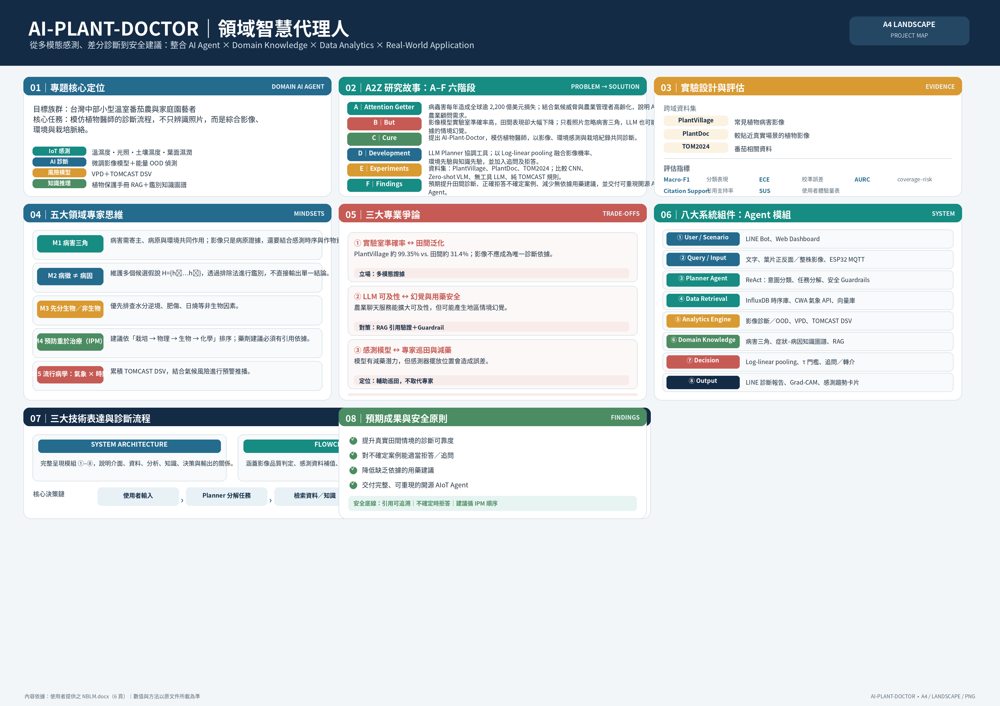
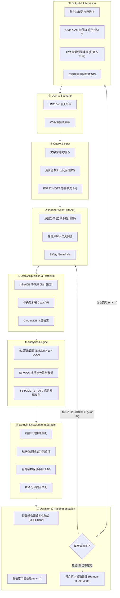

# AI Plant Doctor (植物 AI 醫師)
> **整合 IoT 環境感測、影像診斷與植物病理知識的領域智慧代理人 (Domain AI Agent)**  
> *AI Plant Doctor: A Domain AI Agent Integrating IoT Sensing, Image Diagnosis, and Plant-Pathology Knowledge for Evidence-Based Crop Health Management*

[]()
[]()
[]()
[]()

---

## 👥 專題團隊資訊 (Team Members)

- **課程專題組別**：第 18 組
- **團隊成員**：
  - `7115056017` 劉嘉棟
  - `7115056021` 施閔翎
  - `7115056024` 張承翰
  - `7115056031` 劉俊廷
  - `7115056134` 林泓丞
- **專題代號**：DIC3-AI-Plant-Doctor

---

## 📌 專題總覽資訊圖表 (Project Infographic)



---

## 📖 專題摘要 (Abstract) & A2Z SOP 研究故事

### A. Attention Getter（動機與引題）
- **全球病蟲害損失嚴重**：聯合國糧農組織（FAO）估計，全球每年高達 40% 的作物產量因病蟲害而損失，植物病害每年造成的全球經濟損失逾 2,200 億美元。
- **氣候變遷加劇擴散**：IPPC 科學評估指出氣候變遷擴大了有害生物適生區；最新研究預測至 2050 年，番茄與馬鈴薯青枯病菌適生區將增加 65.34%–71.32%。
- **農業現場人力老化與斷層**：台灣農業經營管理者平均年齡已達 64.4 歲，專家無法親臨每塊田，高齡農友與家庭園藝者常難以自行判讀病徵。
- **AI 顧問時機成熟**：Digital Green 的 FarmerChat 已服務超過 100 萬名農民，將推廣成本降低至原本的 1%；台灣農業部亦宣示邁向「AI 智農 2.0」。

### B. But（挑戰與 Research Gap）
現有 AI 農業診斷方案存在三大結構性瓶頸：
1. **跨域泛化落差（P1）**：在實驗室資料集（如 PlantVillage）準確率高達 99.35% 的影像模型，移至田間真實環境時大幅衰退至 31.4%–66.8%；Zero-shot VLM 亦僅約 62%。
2. **只看照片違背病害三角（P2）**：純影像模型無法辨別外觀極相似的病徵（如早疫病 vs 斑枯病），更無法區分生物性病害與非生物性逆境（如缺水、肥傷、日燒），且不會表示「不確定」。
3. **LLM 農業情境幻覺與用藥風險（P3）**：通用大語言模型缺乏在地化法規與病理實務，常給出不合適或具危險性的用藥建議。

### C. Cure（解藥與核心提案）
提出 **AI Plant Doctor** —— 一個兼具**「看、量、查、問、想」**能力的領域智慧代理人（Domain AI Agent）：
- 模仿專業植物醫師的鑑別診斷思維，綜合**影像特徵**、**IoT 感測時序**、**微氣候模型**與**在地植保知識庫**。
- 以嚴謹的**對數線性融合（Log-linear Pooling）**綜合多源證據，提供具置信區間的診斷。
- 具備**主動追問**與**選擇性拒答（Selective Prediction）**能力，不確定時主動問診或轉介真人植物醫師。
- 嚴格遵守 **IPM（整合性害物管理）** 階層，所有建議必須附帶官方可信文獻引用。

### D. Development（方法與系統設計）
- **IoT 即時串流**：以 ESP32 收集溫濕度、土壤水分、光照與葉面濕潤，透過 MQTT 寫入 InfluxDB。
- **微調影像模型與 OOD 偵測**：以 EfficientNet-B3 / ViT-S 為主幹，結合溫度校準（Temperature Scaling）與 Energy-based OOD 分布外偵測。
- **氣候病害先驗**：即時計算蒸氣壓差（VPD）與累積 TOMCAST DSV（病害嚴重度值）。
- **知識圖譜與 RAG 檢索**：整合植物保護手冊、農改場技術文件與症狀–病因鑑別知識圖譜。
- **ReAct Planner**：以支援 Function Calling 的 LLM 驅動任務分解、工具調度、安全 Guardrails 與問診決策迴圈。

### E. Experiments（實驗與評估規劃）
- **多來源跨域資料集**：PlantVillage 番茄子集（訓練）、PlantDoc 與 TOM2024 田間真實影像（跨域測試）、WUR Autonomous Greenhouse 公開感測資料。
- **四類 Baseline 對比**：純影像 CNN、Zero-shot VLM、無工具純文字 LLM、純規則式 TOMCAST 系統。
- **多維評估指標**：Macro-F1、預測校準誤差（ECE）、選擇性預測 Coverage-Risk（AURC）、建議引用支持率、專家評估（正確性/安全性/可行性）與使用者 SUS 量表。

### F. Findings（預期成果）
- 顯著縮減實驗室至田間的準確度落差，透過拒答機制壓低田間誤診風險。
- 達成 100% 藥劑建議引用驗證，徹底消除無依據用藥的情境幻覺。
- 交付完整開源 AIoT Agent 專題成果（包含軟硬體設計圖、通訊協定、原始碼與評測紀錄）。

---

## 🧠 植物病理專家思維與專業爭論

### 5 大核心專家思維模式 (Five Core Mindsets)

| 編號 | 專家思維 | 核心意涵 | 本專題系統實作對策 |
|:---:|:---|:---|:---|
| **M1** | **病害三角 (Disease Triangle)** | 病害發生取決於「感病寄主 × 致病病原 × 有利環境」，且隨時間演化。 | 影像僅視為病原證據之一；系統強制調用 ESP32 感測時序（環境）與作物歷史紀錄（寄主）融合判斷。 |
| **M2** | **病徵 ≠ 病因（鑑別診斷）** | 相同病徵可能由不同病因引起；病兆（菌絲、孢子）比病徵（枯黃）更具決定性。 | 代理人維護候選假說集合 $H=\{h_1, \dots, h_k\}$，依據排除法逐步縮減，絕不武斷輸出 Top-1。 |
| **M3** | **先分生物性與非生物性** | 均勻分布、邊界整齊、跨品種發生的傷害多為水分、肥傷或日燒逆境。 | 優先檢視環境 VPD 與土壤水分；若屬乾旱或過濕逆境，先行排除或提示非生物性因素。 |
| **M4** | **預防重於治療 (IPM)** | 防治手段嚴格依循「栽培管理 $\rightarrow$ 物理防治 $\rightarrow$ 生物防治 $\rightarrow$ 化學藥劑」。 | 藥劑僅作為最後手段；系統強制 Guardrail 檢查，未附官方登記用藥引用來源者禁止輸出。 |
| **M5** | **流行病學（氣象 × 時間）** | 孢子萌發與感染需要特定溫度區間與連續葉面濕潤時數的累積。 | 實作 TOMCAST DSV（0–4分）累積演算法；當累積達 15 時主動發送推播預警，而非事後才通報。 |

---

### 3 大專業爭論與本專題立場 (Controversies & Positions)

1. **爭論一：實驗室高準確率 vs. 田間泛化能力**
   - *爭論*：實驗室模型達 99% 準確，但在田間雜亂背景與多重光影下劇降至 30%–60%。
   - *本專題立場*：不追求單純在實驗室衝高指標；將影像降為「多源證據之一」，搭配 OOD 分布外偵測與環境先驗融合，並以 PlantDoc/TOM2024 做跨域驗證。
2. **爭論二：LLM 顧問普及性 vs. 幻覺與用藥安全**
   - *爭論*：LLM 對話極為友善便利，但易產生跨國法規混淆的情境幻覺與違法用藥建議。
   - *本專題立場*：建立台灣在地農業專門知識庫 RAG，實施引用嚴格檢查；未達信心門檻 $\tau$ 則轉介真人專家，防止模型胡言亂語。
3. **爭論三：感測模型驅動 vs. 專家巡田與減藥**
   - *爭論*：預警模型能節省 18%–55% 藥劑，但感測器擺放位置（冠層內 vs 邊緣）會產生偏差，模型無法完全取代真人實地巡查。
   - *本專題立場*：系統定位為「專家人力的延伸與巡田輔助工具」；引導農民拍攝葉片正背面與全株，並在模型中將感測擺放點設為校正參數。

---

## 🏗️ 系統架構 (System Architecture)

系統完整涵蓋 8 大模組組件（①–⑧）：



---

## ⚙️ 核心演算法 (Algorithms)

### 1. 證據融合公式 (Log-linear Evidence Pooling)
系統為候選假說 $h \in \mathcal{H}$ 計算綜合評分：

$$\text{score}(h) \propto P_{\text{img}}(h \mid I)^{w_1} \cdot P_{\text{env}}(h \mid S)^{w_2} \cdot P_{\text{kb}}(h \mid K)^{w_3}$$

- $P_{\text{img}}(h \mid I)$：校準後的影像機率向量（經 Temperature Scaling 與 Energy OOD 過濾）。
- $P_{\text{env}}(h \mid S)$：依據過去 24–72 小時 IoT 感測串流計算之環境先驗（Algorithm 2）。
- $P_{\text{kb}}(h \mid K)$：知識圖譜與 RAG 檢索之病理先驗。
- 任何一項證據若出現嚴重矛盾（機率趨近於 0），對數乘積即可實現強行「一票否決」。

---

### 2. 演算法虛擬碼 (Pseudocode)

#### Algorithm 1: AI Plant Doctor Agent (鑑別診斷主迴圈)
```python
Algorithm 1: AI Plant Doctor Agent (Differential Diagnosis Loop)
Input : user query Q, optional leaf image I, plant id p, prior answers A (initially ∅)
Output: report R = (status, ranked diagnosis D, recommendations, evidence, citations)

01: intent ← LLM.classify_intent(Q)                    # diagnose / care / alert / qa
02: tasks ← LLM.decompose(Q, intent)                   # sub-task plan
03: if I ≠ ∅ then
04:     if not QualityCheck(I) then
05:         return R(status=RETAKE_PHOTO, guidance)    # 影像過曝/模糊提示重拍
06:     (P_img, ood) ← ImageModel.predict_calibrated(I)
07: else
08:     P_img ← ∅; ood ← 1
09: S ← get_sensor_window(p, 72h); W ← get_weather(p)
10: S ← Preprocess(S)                                  # 補值、去雜訊、漂移校正
11: if Missing(S) > 30% then mark w_env ← w_env / 2    # 感測缺值降權
12: P_env ← EnvironmentalPrior(S, W)                   # Algorithm 2
13: docs ← search_kb(Q ⊕ A); P_kb ← KG.prior(symptoms(Q, A))
14: H ← Candidates(P_img ∪ P_env ∪ P_kb) ∪ AbioticCauses
15: D ← Fuse(P_img, P_env, P_kb, ood)                  # 對數線性池化融合排序
16: (h*, c) ← top(D)
17: conflict ← (argmax(P_img) ≠ h*)
18: if c < τ or conflict then
19:     if |A| ≥ 2 then return R(REFER_EXPERT, D, evidence) # 超過兩輪轉介專家
20:     q ← LLM.follow_up_questions(H, D); return R(FOLLOW_UP, D, q)
21: rec ← LLM.generate(h*, docs, rule="IPM tiers; cite every claim")
22: if not AllClaimsCited(rec, docs) then rec ← RemoveUncited(rec) # 防幻覺過濾
23: R ← (OK, D, rec, evidence={P_img, P_env, Grad-CAM, trends}, citations=docs)
24: SaveHistory(p, R); return R
```

#### Algorithm 2: IoT 環境病害先驗計算 (TOMCAST & VPD)
```python
Algorithm 2: Environmental Prior from IoT Sensors (Disease Triangle)
Input : hourly series T[1..24], RH[1..24], optional wetness sensor LW[1..24]
Output: prior P_env(h) ∈ [0,1] for each hypothesis h

01: wet_h ← if LW given then Σ LW[i] else Σ [RH[i] ≥ 90%]   # 葉面濕潤時數
02: T_wet ← mean{ T[i] | hour i is wet }
03: DSV ← TOMCAST_TABLE(wet_h, T_wet)                       # 每日嚴重度值 0..4
04: VPD ← mean_i 0.6108 · exp(17.27 · T[i] / (T[i] + 237.3)) · (1 - RH[i] / 100)
05: P_env(early_blight) ← DSV / 4; P_env(septoria) ← DSV / 4
06: P_env(gray_mold) ← fraction of hours with (15 ≤ T ≤ 25 °C and RH ≥ 90%)
07: P_env(powdery_mildew) ← 1.0 if wet_h < 4 and 0.4 ≤ VPD ≤ 1.2 else 0.3
08: P_env(abiotic_water_stress) ← clip((VPD - 1.5) / 1.5, 0, 1)
09: Acc ← Acc + DSV; if Acc ≥ 15 then push ALERT and reset Acc  # TOMCAST 噴藥門檻
10: return P_env
```

---

## 🛠️ 技術堆疊 (Tech Stack)

| 層級 | 核心組件 / 技術 | 說明 |
|:---|:---|:---|
| **端點感測硬體** | ESP32 開發板 | Wi-Fi / BLE 支援，微型控制器 |
| **感測元件** | SHT31, BH1750, 電容式土壤感測器, 葉濕感測板 | 溫濕度、環境光照、土壤容積含水量、葉面水膜感測 |
| **通訊與時序庫** | MQTT Protocol, InfluxDB | 輕量化感測串流傳輸，高吞吐時序資料儲存 |
| **視覺模型** | EfficientNet-B3 / ViT-S, Grad-CAM | 經 PlantDoc 微調之病害分類器，可視化熱圖特徵解釋 |
| **不確定性量化** | Temperature Scaling, Energy Score OOD | 抑制過度自信預測，濾除雜草/非葉片/異常影像 |
| **向量檢索 (RAG)** | ChromaDB, LangChain / LlamaIndex | 收錄台灣植物保護手冊、農業部防檢署推薦用藥文獻 |
| **代理人核心** | ReAct Planner, Function Calling (Qwen / GPT-4o) | 意圖識別、子任務拆解、問診追問生成、Guardrails 檢查 |
| **前端應用介面** | LINE Messaging API, Streamlit / Next.js Dashboard | 手機端低門檻拍照互動、溫室微氣候即時監控儀表板 |

---

## 🧪 實驗與評估設計 (Experiments & Evaluation)

### 1. 資料集規劃 (Datasets)
- **模型訓練與基準調校**：`PlantVillage` 番茄 10 類影像（54,306 張）。
- **田間真實跨域測試**：`PlantDoc`（2,598 張真實農田影像）與 `TOM2024` 番茄子集。
- **環境時序模擬管線**：荷蘭瓦赫寧恩大學 `WUR Autonomous Greenhouse Challenge` 公開感測資料集。

### 2. 比較基準 (Baselines)
- **B1 (純影像模型)**：標準 EfficientNet-B3。
- **B2 (視覺語言模型)**：Zero-shot VLM（Qwen-VL / GPT-4V）。
- **B3 (純對話模型)**：無工具調度、無 RAG 的純文字 LLM。
- **B4 (純經驗規則)**：傳統 TOMCAST 規則式預警系統。

### 3. 評估指標 (Metrics)
- **診斷指標**：Top-1 Accuracy、Macro-F1、ECE（預期校準誤差）、AURC（選擇性預測 Coverage-Risk 曲線下方面積）。
- **建議安全性與防幻覺**：主張引用支持率（Citation Support Rate，每條處置主張是否皆能追溯至知識庫）。
- **專家主觀評測**：邀請具植物保護背景專家就診斷正確性、用藥安全性與可行性進行 1–5 分雙盲審核。
- **系統與可用性**：端到端對話延遲（目標 $< 10$ 秒）、感測資料缺漏補值率、使用者 SUS（System Usability Scale）滿意度量表。

---

## 📂 專案檔案結構 (Repository Structure)

```plaintext
DIC3-AI-Plant-Doctor/
├── README.md                                  # 專題核心完整說明文件 (本檔案)
├── AI_Plant_Doctor_Infographic_A4_Landscape.png # A4 橫式 300DPI 完整架構與思維資訊圖表
├── AI_Plant_Doctor提案.docx                    # 完整期末書面提案報告
├── AI_Plant_Doctor提案簡報.pptx                # 提案簡報投影片 (24 頁完整版)
├── 提案分析.pdf                                # 期末規範對齊與要點分析報告
├── Perplexity聊天紀錄.pdf                      # Deep Research 文獻探討與調研歷程
├── AI-Plant-Doctor_Conversation_Record.md     # 專題討論整理紀錄
├── myplan/
│   └── AI-Plant-Doctor_Conversation_Record.md # 依規劃存放之討論紀錄副本
└── .gitignore                                 # Git 忽略檔案設定
```

---

## 📚 參考文獻 (References)

1. **FAO**, *"Climate change fans spread of pests and threatens plants and crops, new FAO study,"* FAO Newsroom, 2021.
2. **IPPC Secretariat (M. L. Gullino et al.)**, *Scientific review of the impact of climate change on plant pests*, Rome: FAO, 2021. doi:10.4060/cb4769en.
3. **S. Savary et al.**, *"The global burden of pathogens and pests on major food crops,"* *Nature Ecology & Evolution*, 3, 430–439, 2019.
4. **M. Hubab et al.**, *"Climate change-driven shifts in the global distribution of tomato and potato crops and their associated bacterial pathogens,"* *Frontiers in Microbiology*, 16:1520104, 2025.
5. **行政院主計總處**，〈109 年農林漁牧業普查總報告統計結果〉，2023。
6. **農業部**，〈114 年年報：推動智慧農業〉，2026；〈明年邁向 AI 智農 2.0〉，2026。
7. **BCC Research**, *"AI in Agriculture Market to Reach $8.5 Billion by 2030,"* Press Release, 2026.
8. **Rural Voice**, *"Digital Green's AI Farming Assistant Crosses 10 Lakh Users,"* 2026.
9. **S. P. Mohanty, D. P. Hughes, M. Salathé**, *"Using deep learning for image-based plant disease detection,"* *Frontiers in Plant Science*, 7:1419, 2016.
10. **Z. Salman, A. Muhammad, D. Han**, *"Plant disease classification in the wild using vision transformers and mixture of experts,"* *Frontiers in Plant Science*, 16, 2025.
11. **S. Kajan et al.**, *"Automatic vineyard health control: A review of existing systems and datasets for disease identification,"* *Journal of Electrical Engineering*, 77(4), 444–459, 2026.
12. **X. Liu et al.**, *"A multimodal benchmark dataset and model for crop disease diagnosis (CDDM),"* in *ECCV 2024*, LNCS.
13. **R. Shinoda et al.**, *"AgroBench: Vision-language model benchmark in agriculture,"* in *ICCV 2025*, pp. 7634–7644.
14. **E. Ranario, J. M. Earles**, *"Are vision-language models ready to zero-shot replace supervised classification models in agriculture?"* *arXiv:2512.15977*, 2025.
15. **B. Yang et al.**, *"AgriGPT: A large language model ecosystem for agriculture,"* *arXiv:2508.08632*, 2025.
16. **M. Fanuel et al.**, *"AgriRegion: Region-aware retrieval for high-fidelity agricultural advice,"* *arXiv:2512.10114*, 2025.
17. **G. Ramesh Babu et al.**, *"Integrating IoT for soil monitoring and hybrid machine learning in predicting tomato crop disease,"* *Sensors*, 24(19):6177, 2024.
18. **S. Yang, Z. Liu, W. Mayer**, *"ShizishanGPT: An agricultural large language model integrating tools and resources,"* in *WISE 2024*.
19. **L. J. Francl**, *"The disease triangle: A plant pathological paradigm revisited,"* *The Plant Health Instructor*, APS, 2001.
20. **AHDB / James Hutton Institute**, *"Development and implementation of a new national warning system for potato late blight in Great Britain (Hutton Criteria),"* 2017.
21. **Q. Li et al.**, *"Evaluating the applicability of the TOMCAST model for the control of potato early blight in China,"* *Plants*, 12(8):1634, 2023.
22. **M. Son et al.**, *"Predicting the onset date of cucumber powdery mildew based on growing degree days and leaf wetness duration in greenhouse environment,"* *Plant Pathology Journal*, 41(3), 419–424, 2025.
23. **S. D. Cosseboom et al.**, *"Impact of floating row cover and sensor placement on strawberry anthracnose and Botrytis fruit rot risk assessment,"* *Plant Pathology*, 72(4), 819–828, 2023.
24. **M. Hu et al.**, *"Validation of the Strawberry Advisory System in the Mid-Atlantic region,"* *Plant Disease*, 105(9), 2670–2679, 2021.
25. **K. Yang et al.**, *"Effects of different soil moisture on the growth, quality, and root rot disease,"* *Journal of Environmental Management*, 329:117069, 2023.
26. **FAO**, *"Integrated Pest Management (IPM) Principles and Guidelines,"* Rome.
27. **Penn State Extension**, *"Overview of Plant Diagnostics,"* 2021.
28. **D. P. Hughes, M. Salathé**, *"An open access repository of images on plant health to enable mobile disease diagnostics (PlantVillage),"* *arXiv:1511.08060*, 2015.
29. **D. Singh et al.**, *"PlantDoc: A dataset for visual plant disease detection in the wild,"* in *CoDS-COMAD 2020*, pp. 249–253.
30. **O. Appiah et al.**, *"TOM2024: Datasets of tomato, onion, and maize images for developing pests and diseases AI models,"* *Data in Brief*, 59:111357, 2025.
31. **Wageningen University & Research**, *"4th Autonomous Greenhouse Challenge dataset,"* 4TU.ResearchData, 2024.
32. **M. Lechenet et al.**, *"Reducing pesticide use while preserving crop productivity and profitability on arable farms,"* *Nature Plants*, 3, 17008, 2017.
33. **D. C. Rose et al.**, *"Decision support tools for agriculture: Towards effective design and delivery,"* *Agricultural Systems*, 149, 165–174, 2016.
34. **N. Rai et al.**, *"Advancing site-specific disease and pest management in precision agriculture,"* *arXiv:2510.24650*, 2025.
35. **L. V. Madden, S. P. Pennypacker, A. A. MacNab**, *"FAST, a forecast system for Alternaria solani on tomato,"* *Phytopathology*, 68, 1354–1358, 1978.
36. **R. G. Allen et al.**, *Crop Evapotranspiration — Guidelines for Computing Crop Water Requirements*, FAO Irrigation and Drainage Paper 56, 1998.
